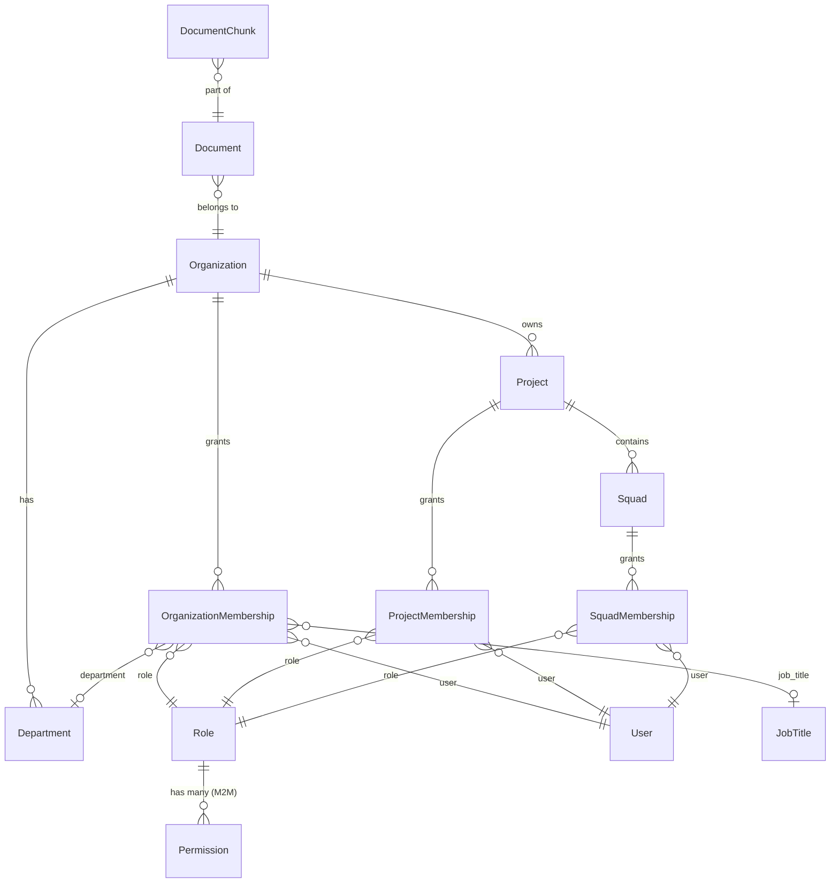

# AI-Control — Backend de Governança Multi-Tenant

> **Plataforma de atendimento inteligente com IA, CRM integrado ao WhatsApp e governança hierárquica RBAC.**

---

## 🎯 Visão Geral

O **AI-Control** é o backend unificado que orquestra:

| Módulo | O que faz |
|---|---|
| **RBAC Hierárquico** | Organização → Projeto → Squad, com permissões por escopo |
| **CRM Multi-Tenant** | Contatos, conversas e WhatsApp Gateway (Evolution API) |
| **Base de Conhecimento (RAG)** | Ingestão de documentos com embedding vetorial e busca semântica |
| **Data Vault** | Consentimento LGPD, grants de acesso e auditoria completa |
| **Gamificação** | Perfil de participante com wallet, streaks e níveis de autonomia |

---

## 🏗️ Arquitetura do RBAC

O sistema usa um modelo **hierárquico de 4 camadas** com validação P3 (participação obrigatória no nível acima):

```
PLATFORM          ← superadmin, suporte, bot
  └── ORGANIZATION    ← admin, gestor, supervisor, atendente, membro, convidado
        └── PROJECT       ← coordenação, membro, observador
              └── SQUAD       ← líder, membro, observador
```

### Princípios Fundamentais

| Princípio | Descrição |
|---|---|
| **P1 — Escopo** | Todo `Role` pertence a um escopo (PLATFORM, ORG, PROJECT, SQUAD) |
| **P2 — Nível** | Roles têm `level` numérico para resolver conflitos (90 > 30) |
| **P3 — Cadeia** | Membership em Project exige membership ativa na Organization; Squad exige Project |
| **P4 — Permissões** | Cada Role contém N Permissions (`domain.action`), verificáveis via middleware |
| **P5 — RAG Scoped** | Documentos têm `visibility` (ORG, DEPT, PROJECT, SQUAD, PRIVATE) para pré-filtrar a busca vetorial |

### Catálogo de Dados (Seed)

O `migrate` cria automaticamente:

- **30 Permissões** — organizadas por domínio (`org.*`, `project.*`, `squad.*`, `document.*`, `conversation.*`, `bot.*`)
- **15 Roles** — 3 de plataforma, 6 organizacionais, 3 de projeto, 3 de squad
- **40 Cargos (JobTitles)** — corporativos, acadêmicos e técnicos
- **Organização Interna** — "AI Control (Plataforma)" com 8 departamentos, 1 projeto operacional, 2 squads
- **Usuários de Sistema** — `admin` (superadmin), `suporte`, `ai-bot`

---

## 🚀 Instalação

### Pré-requisitos

- Python 3.12+
- PostgreSQL 15+ com extensão `pgvector`
- Redis (para Channels/Celery)

### Setup Rápido

```bash
# 1. Clone e entre no projeto
cd ~/projetos/assistidos/ai-control

# 2. Crie o virtualenv
python -m venv .venv
source .venv/bin/activate

# 3. Instale as dependências
pip install -r requirements.txt

# 4. Configure o .env (veja .env.example)
cp .env.example .env
# Edite: DJANGO_SECRET_KEY, DATABASE_URL, REDIS_URL, etc.

# 5. Crie a extensão pgvector no PostgreSQL
psql -U postgres -d ai_control_db -c "CREATE EXTENSION IF NOT EXISTS vector;"

# 6. Execute as migrações (cria schema + catálogo RBAC + org interna)
python manage.py migrate

# 7. Defina a senha do admin
python manage.py changepassword admin

# 8. Inicie o servidor de desenvolvimento
python manage.py runserver
```

### Variáveis de Ambiente Importantes

| Variável | Descrição | Default |
|---|---|---|
| `DJANGO_SECRET_KEY` | Chave secreta do Django | `django-insecure-default` |
| `DATABASE_URL` | URL do PostgreSQL | — |
| `BOT_USER_USERNAME` | Username do agente IA | `ai-bot` |
| `AICONTROL_ADMIN_PASSWORD` | Senha do admin no migrate (opcional) | *(bloqueada)* |
| `AICONTROL_SUPPORT_PASSWORD` | Senha do suporte no migrate (opcional) | *(bloqueada)* |
| `DEMO_PASSWORD` | Senha dos usuários demo | `demo1234` |

---

## 🧪 Testes

```bash
# Todos os testes
python -m pytest -v

# Apenas RBAC
python -m pytest core/tests/test_rbac.py -v

# Com cobertura
python -m pytest --cov=core --cov-report=term-missing
```

### O que os testes cobrem

- ✅ Criação de memberships nos 3 níveis
- ✅ Rejeição P3 (squad sem project, project sem org)
- ✅ Validação de escopo errado (role de PROJECT em membership de ORG)
- ✅ Colaborador externo exige `org_guest`
- ✅ Middleware RBAC no gateway (permitir admin, rejeitar membro)

---

## 🎲 Dados de Demonstração

```bash
# Cria universidade + empresa demo com ~13 usuários
python manage.py seed_demo

# Apenas o perfil acadêmico
python manage.py seed_demo --profile=academic

# Apenas o corporativo
python manage.py seed_demo --profile=corporate

# Limpar e recriar
python manage.py seed_demo --flush
python manage.py seed_demo
```

### Organizações Demo

| Org | Tipo | Projetos | Squads |
|---|---|---|---|
| Universidade Federal Demo | ACADEMIC | Saúde Digital, IA Triagem | App Móvel, Campo-Coleta, Modelagem, Dados Clínicos |
| Empresa Demo Ltda | COMPANY | Implantação CRM WhatsApp | Integração, Conteúdo do Bot |

---

## 📁 Estrutura do Projeto

```
ai-control/
├── config/
│   └── settings/
│       ├── base.py          # Configuração base
│       └── local.py         # Dev overrides
├── core/
│   ├── models.py            # Todos os modelos (RBAC, CRM, RAG, Profiles)
│   ├── admin.py             # Django Admin com inlines
│   ├── middleware.py         # RBAC middleware para gateway
│   ├── apps.py              # Patches para compatibilidade
│   ├── management/
│   │   └── commands/
│   │       └── seed_demo.py # Dados de demonstração
│   ├── migrations/
│   │   ├── 0001–0004        # Schema original
│   │   ├── 0007_*           # Schema RBAC hierárquico
│   │   ├── 0008_*           # Seed: catálogo RBAC (permissions, roles, job titles)
│   │   └── 0009_*           # Seed: org interna + usuários de sistema
│   └── tests/
│       └── test_rbac.py     # Testes do RBAC hierárquico
├── pytest.ini
├── requirements.txt
└── README.md                # ← Você está aqui
```

---

## 📊 Modelos Principais



---

## 🔐 Segurança

- **PII Criptografada** — `full_name`, `cpf`, `phone_number` via `django-crypto-fields`
- **Blind Indexing** — Busca por nome sem descriptografar (tokens SHA-256)
- **Auditoria Completa** — `AuditLog` com actor, action, detalhes e snapshot do raciocínio da IA
- **LGPD/GDPR** — `ConsentLog` + `DataAccessGrant` com expiração e revogação
- **Bot Isolado** — Usuário `ai-bot` com permissões mínimas (`bot.send_message`, `bot.read_knowledge`, `rag.query`)

---

## 📝 Licença

Uso interno — Projeto AI-Control.
