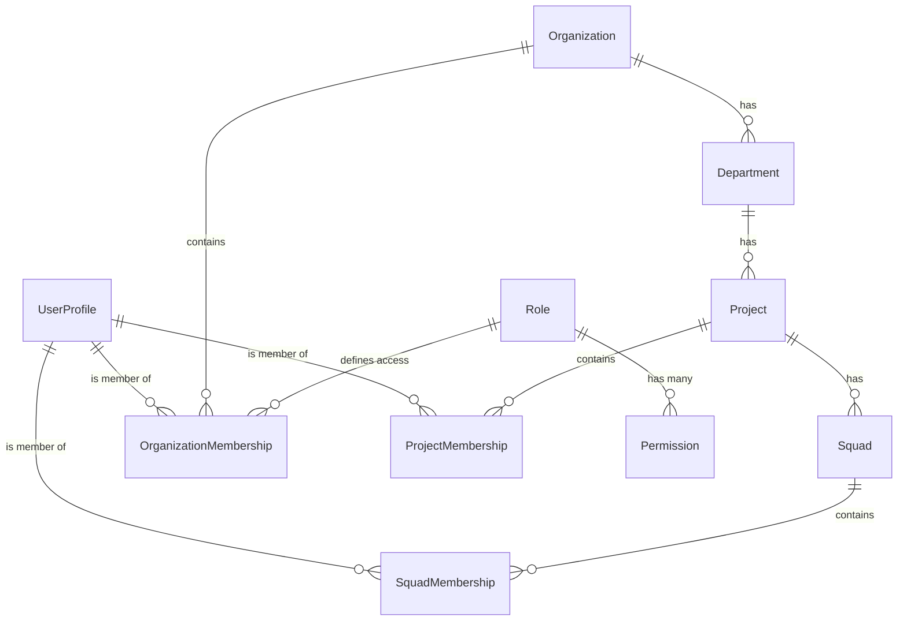

<!-- 01_modelo_de_dados_rbac.md | Vitalia SDD v0.6.0 | 08-10-2026 00:00(GMT-04:00) -->
<!-- Commit de referência: 686d444 -->

# 01. Modelo de Dados e RBAC Matricial
**Público-alvo:** Desenvolvedores Backend
**Tempo de Leitura:** 8 min

A arquitetura do `ai-control` utiliza um RBAC Matricial altamente normalizado. A principal classe de herança abstrata é `BaseMembership`, de onde as filhas (`OrganizationMembership`, `ProjectMembership`, `SquadMembership`) herdam. O isolamento de Tenant reside na `Organization`.

## 1. Diagrama de Relacionamento (ER) ✅



## 2. Abstração `BaseMembership` ✅

Toda tabela de Membership é filha de `BaseMembership`.
Em `core/models.py`, esta classe define os campos obrigatórios `role` e `job_title`.

**A diferença vital:**
- `Role`: FK para a tabela estática que detém as permissões de sistema (`Permissions`). Exemplo: `manager`.
- `JobTitle`: FK para a tabela de cargos (`JobTitle`) que define o nível do cargo. Exemplo: `Professor`.

### Regra de Integridade (Constraints)
Existe uma `UniqueConstraint` e o método `clean()`. Você **não pode** inserir um usuário num `Squad` se ele não tiver uma `ProjectMembership` ativa no projeto pai. (Constraint de "Containment Rule").

## 3. ORM vs SQL Bruto ✅

Quando você busca todos os projetos onde a Professora Ana (id=2) tem o cargo textual de "Coordenadora", o ORM faz:
```python
Project.objects.filter(memberships__user_id=2, memberships__job_title__icontains='Coordenador')
```

**Em SQL Equivalente:**
```sql
SELECT "core_project"."id", "core_project"."name" 
FROM "core_project" 
INNER JOIN "core_projectmembership" 
  ON ("core_project"."id" = "core_projectmembership"."project_id") 
WHERE ("core_projectmembership"."user_id" = 2 
  AND "core_projectmembership"."job_title" ILIKE '%Coordenador%')
```

## Laboratório Recomendado
Acesse o laboratório de inicialização para visualizar esta criação no terminal.
`python manage.py shell < docs/manuals/02-engineering/labs/lab_01_hierarquia_rbac.py`
