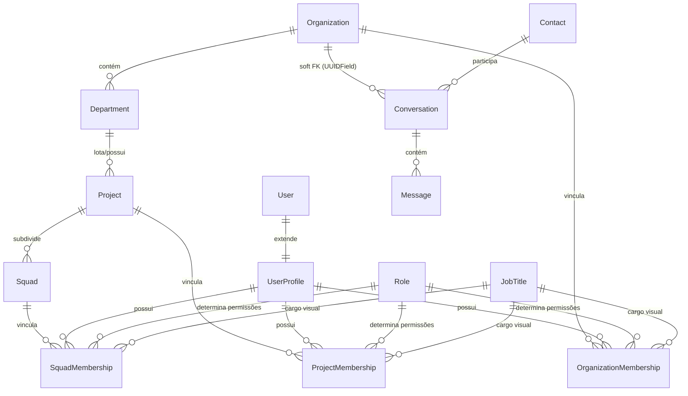

<!-- data-model.md | Vitalia SDD v0.6.0 | 11-10-2026 20:42(GMT-04:00) -->
**data-model.md | AI-Control v0.0.1 | 11-10-2026 20:42(GMT-04:00)**

# Data Model: Frontend v1 & Adequação do Seed Demo

Este documento descreve os modelos de dados afetados, as entidades persistidas no processo de seed e a estrutura dos payloads da API síncrona.

---

## 1. Entidades Semeadas (Demonstração e Testes)

---

## 2. Especificação das Tabelas e Registros Canônicos

### 2.1 Organizações de Demonstração
- **`ufdemo`**:
  - `name`: `"Universidade Federal Demo"`
  - `slug`: `"ufdemo"`
  - `org_type`: `ACADEMIC`
  - `is_internal`: `False`
- **`empresa-demo`**:
  - `name`: `"Empresa Demo Ltda"`
  - `slug`: `"empresa-demo"`
  - `org_type`: `COMPANY`
  - `is_internal`: `False`

### 2.2 Departamentos (`Department`)
- **UFDemo (6)**:
  - `DCOMP`: `name="Departamento de Computação"`, `slug="dcomp"`, `code="DCOMP"`
  - `PROPESQ`: `name="Pró-Reitoria de Pesquisa"`, `slug="propesq"`, `code="PROPESQ"`
  - `PROEC`: `name="Pró-Reitoria de Extensão"`, `slug="proec"`, `code="PROEC"`
  - `DENF`: `name="Departamento de Enfermagem"`, `slug="denf"`, `code="DENF"`
  - `FIN`: `name="Departamento Financeiro"`, `slug="fin"`, `code="FIN"`
  - `SGP`: `name="Superintendência de Gestão de Pessoas"`, `slug="sgp"`, `code="SGP"`
- **Empresa Demo (5)**:
  - `TI`: `name="Tecnologia da Informação"`, `slug="ti"`, `code="TI"`
  - `ATD`: `name="Atendimento"`, `slug="atd"`, `code="ATD"`
  - `FIN`: `name="Financeiro"`, `slug="fin-empresa"`, `code="FIN"`
  - `RH`: `name="Recursos Humanos"`, `slug="rh"`, `code="RH"`
  - `COM`: `name="Comercial"`, `slug="com"`, `code="COM"`

### 2.3 Projetos e Squads
- **Projeto `saude-digital` (UFDemo)**:
  - `name`: `"Saúde Digital na Comunidade"`, `slug`: `"saude-digital"`, `project_type`: `EXTENSION`, `status`: `ACTIVE`, `owner_department`: `PROEC`
  - **Squads**:
    - `app-movel`: `name="Squad App Móvel"`, `slug="app-movel"`
    - `campo-coleta`: `name="Squad Campo-Coleta"`, `slug="campo-coleta"`
- **Projeto `ia-triagem` (UFDemo)**:
  - `name`: `"IA para Triagem Clínica"`, `slug`: `"ia-triagem"`, `project_type`: `RESEARCH`, `status`: `ACTIVE`, `owner_department`: `PROPESQ`
  - **Squads**:
    - `modelagem`: `name="Squad Modelagem"`, `slug="modelagem"`
    - `dados-clinicos`: `name="Squad Dados Clínicos"`, `slug="dados-clinicos"`
- **Projeto `implantacao-crm` (Empresa Demo)**:
  - `name`: `"Implantação CRM WhatsApp"`, `slug`: `"implantacao-crm"`, `project_type`: `CORPORATE`, `status`: `ACTIVE`, `owner_department`: `TI`
  - **Squads**:
    - `integracao`: `name="Squad Integração"`, `slug="integracao"`
    - `conteudo-bot`: `name="Squad Conteúdo do Bot"`, `slug="conteudo-bot"`

---

## 3. Matriz de Usuários, Membresias e Criptografia (PII)

Todos os usuários demo são criados com senha padrão `demo1234` e `is_active=True`.

| Username | Nome Completo (Cleartext) | Blind Index Hashes (`search_tokens`) | Nível Org (Role + JobTitle + Depto) | Vínculo Projeto | Vínculo Squad |
|---|---|---|---|---|---|
| `prof.ana` | Profa. Ana Santos | Gerado auto via save() | `org_member` + `professor` + `DCOMP` | `saude-digital` (`project_lead` + `project_coordinator`); `ia-triagem` (`project_member` + `collaborating_researcher`) | `app-movel` (`squad_lead` + `tech_lead`) |
| `prof.carlos` | Prof. Carlos Eduardo | Gerado auto via save() | `org_manager` + `pro_rector` + `PROPESQ` | `ia-triagem` (`project_lead` + `project_coordinator`) | *Nenhum* |
| `prof.lucia` | Profa. Lúcia Oliveira | Gerado auto via save() | `org_member` + `professor` + `DENF` | `saude-digital` (`project_lead` + `project_coordinator`) | `campo-coleta` (`squad_lead` + `squad_leader`) |
| `aluno.joao` | João Victor Aluno | Gerado auto via save() | `org_member` + `undergrad_student` + `DCOMP` | `saude-digital` (`project_member` + `scholarship_holder`) | `app-movel` (`squad_member` + `developer`) |
| `aluna.maria` | Maria Clara Aluna | Gerado auto via save() | `org_member` + `masters_student` + `DCOMP` | `ia-triagem` (`project_member` + `scholarship_holder`) | `modelagem` (`squad_member` + `developer`) |
| `pesq.externo` | Dr. Roberto Pesquisador | Gerado auto via save() | `org_guest` + `researcher` + *N/A* | `ia-triagem` (`project_member` + `collaborating_researcher`) | `dados-clinicos` (`squad_member` + `developer`) |
| `tae.paulo` | Paulo Henrique TAE | Gerado auto via save() | `org_member` + `technician` + `FIN` | *Nenhum* | *Nenhum* |
| `gerente.ti` | Roberto Gerente TI | Gerado auto via save() | `org_manager` + `manager` + `TI` | `implantacao-crm` (`project_lead` + `project_manager`) | `integracao` (`squad_lead` + `tech_lead`) |
| `dev.rafa` | Rafael Dev Silva | Gerado auto via save() | `org_member` + `analyst` + `TI` | `implantacao-crm` (`project_member` + `developer`) | `integracao` (`squad_member` + `developer`) |
| `supervisor.bia` | Beatriz Supervisora | Gerado auto via save() | `org_supervisor` + `supervisor` + `ATD` | `implantacao-crm` (`project_lead` + `product_owner`) | `conteudo-bot` (`squad_lead` + `squad_leader`) |
| `atendente.leo` | Leonardo Atendente | Gerado auto via save() | `org_agent` + `attendant` + `ATD` | *Nenhum* | *Nenhum* |
| `analista.rh` | Fernanda Analista RH | Gerado auto via save() | `org_member` + `analyst` + `RH` | *Nenhum* | *Nenhum* |
| `diretora.fin` | Patrícia Diretora FIN | Gerado auto via save() | `org_admin` + `director` + `FIN` | `implantacao-crm` (`project_member` + `sponsor`) | *Nenhum* |

---

## 4. Dados Mockados do Domínio `omnichannel` (Soft FKs)

- **Contatos (`Contact`)**:
  - `JID: 5511000000001@example.org` (Nome: "Profa. Ana Santos", Org: `ufdemo.id`)
  - `JID: 5511000000002@example.org` (Nome: "João Victor Aluno", Org: `ufdemo.id`)
  - `JID: 5511000000003@example.org` (Nome: "Roberto Gerente TI", Org: `empresa-demo.id`)
- **Conversas (`Conversation`)**:
  - Status: `ACTIVE_AI` (`Conversation.Status.ACTIVE_AI`)
  - Associação: `organization_id = org.id` (`UUIDField` - Soft FK)
  - Flags de IA: `context_locked = False`, `consecutive_rag_failures = 0`
- **Mensagens (`Message`)**:
  - Mensagens de exemplo simulando interação via gateway sob instâncias `ai_control_ufdemo` e `ai_control_empresa_demo`.
