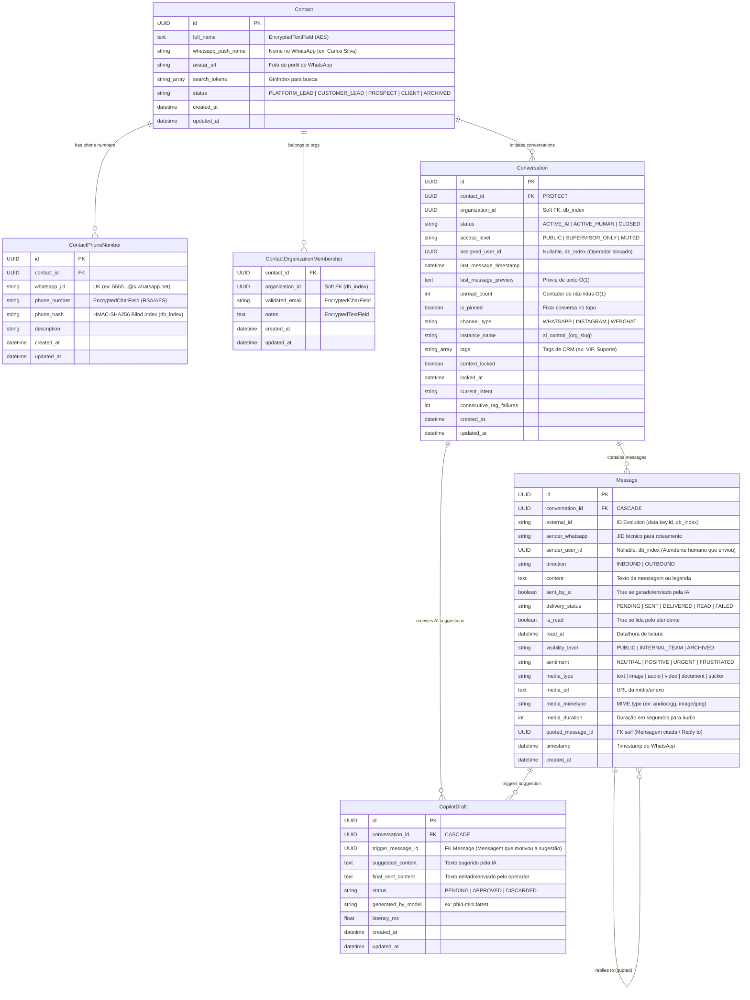

<!-- data-model.md | Vitalia SDD v0.6.0 | 20-10-2026 18:02:00(GMT-04:00) -->
> **data-model.md | Vitalia SDD v0.6.0 | 20-10-2026 18:02:00(GMT-04:00)**

# Data Model: 005-omnichannel-integration (Arquitetura Completa e Blindagem de PII)

Este documento especifica o modelo de dados completo do módulo Omnichannel, preservando a retrocompatibilidade com as tabelas existentes em [omnichannel/models.py](file:///home/andre/projetos/assistidos/ai-control/omnichannel/models.py), adicionando as extensões necessárias para atender 100% dos requisitos da interface do WhatsApp Web e consolidando a **Diretriz Máxima de Proteção de PII**: **o telefone (mesmo mascarado) NUNCA é exibido na lista ou no chat**, sendo substituído exclusivamente pelo **Nome de Exibição (`whatsapp_push_name` / `full_name`)** e **Foto de Perfil (`avatar_url`)**.

---

## 1. Diagrama Entidade-Relacionamento Completo (ERD)

---

## 2. Protocolo de Blindagem e Não-Exibição de PII (LGPD Art. 13 e 46)

Para proteger a privacidade dos clientes finais e blindar o sistema contra vazamento de dados em trânsito e na interface:

1. **Proibição de Telefone na Interface Operacional:**
   - O número de telefone (seja em formato E.164 ou mascarado como `***-7766`) **NÃO** deve ser renderizado:
     - Na lista de conversas (cards à esquerda);
     - No cabeçalho do chat ativo;
     - Nos balões de mensagem.
2. **Hierarquia de Exibição de Identidade (`display_name`):**
   - **Prioridade 1:** `full_name` qualificado no CRM (descriptografado sob permissão);
   - **Prioridade 2:** `whatsapp_push_name` (nome configurado pelo cliente no WhatsApp, ex: "Carlos Silva");
   - **Prioridade 3:** Fallback elegante (`"Lead #<UUID[:4]>"` ou `"Contato Anônimo"`).
3. **Foto de Perfil (`avatar_url`):**
   - Carregada dinamicamente via Evolution API (`/chat/fetchProfilePictureUrl/{instance}`) e salva no `Contact`.
   - Caso não exista foto, a interface exibe as iniciais do `display_name` sobre gradiente suave.
4. **Armazenamento e Busca:**
   - O telefone real existe apenas cifrado em repouso (`phone_number`).
   - A busca relacional rápida ocorre exclusivamente pelo índice cego `phone_hash` (HMAC-SHA256).

---

## 3. Detalhamento dos Modelos e Extensões Não-Destrutivas

### 3.1 `Contact` (Extensão Não-Destrutiva)
- `avatar_url`: TextField (null=True, blank=True) — URL do avatar do WhatsApp.
- `whatsapp_push_name`: CharField(max_length=255, null=True, blank=True) — Nome de exibição vindo do webhook.
- *Campos vigentes mantidos:* `id`, `full_name`, `search_tokens`, `status`, `created_at`, `updated_at`.

### 3.2 `Conversation` (Extensão Não-Destrutiva)
- `unread_count`: PositiveIntegerField(default=0) — Otimização O(1) para badges de não lidas na lista.
- `last_message_preview`: TextField(null=True, blank=True) — Prévia da última mensagem para renderização instantânea da lista.
- `is_pinned`: BooleanField(default=False) — Fixar conversas prioritárias no topo.
- `channel_type`: CharField(max_length=20, default='WHATSAPP') — Suporte a múltiplos canais omnichannel.
- `instance_name`: CharField(max_length=100, null=True, blank=True) — Nome da instância conectada.
- `tags`: ArrayField(models.CharField(max_length=50), blank=True, default=list) — Categorização e tags de CRM.
- *Campos vigentes mantidos:* `id`, `contact`, `organization_id`, `status`, `access_level`, `assigned_user_id`, `last_message_timestamp`, `context_locked`, `locked_at`, `current_intent`, `consecutive_rag_failures`, `created_at`, `updated_at`.

### 3.3 `Message` (Extensão Não-Destrutiva)
- `external_id`: CharField(max_length=255, db_index=True, null=True, blank=True) — ID único da Evolution API (`key.id`) para idempotência e atualização de ticks.
- `delivery_status`: CharField(choices=['PENDING', 'SENT', 'DELIVERED', 'READ', 'FAILED'], default='DELIVERED') — Estado de entrega no WhatsApp (ticks cinzas e azuis).
- `is_read`: BooleanField(default=False) — Leitura da mensagem pelo operador humano.
- `read_at`: DateTimeField(null=True, blank=True) — Timestamp em que o operador visualizou a mensagem.
- `sender_user_id`: UUIDField(null=True, blank=True, db_index=True) — Identificador do atendente humano quando a mensagem for `OUTBOUND` e não for gerada por IA.
- `media_type`: CharField(max_length=20, default='text') — text, image, audio, video, document, sticker.
- `media_url`: TextField(null=True, blank=True) — URL segura da mídia para download/reprodução.
- `media_mimetype`: CharField(max_length=100, null=True, blank=True) — Tipo MIME da mídia.
- `media_duration`: PositiveIntegerField(null=True, blank=True) — Duração em segundos (essencial para player de áudio PTT).
- `quoted_message`: ForeignKey('self', on_delete=models.SET_NULL, null=True, blank=True, related_name='replies') — Citação / resposta contextual a mensagem anterior.
- *Campos vigentes mantidos:* `id`, `conversation`, `sender_whatsapp`, `direction`, `content`, `sent_by_ai`, `visibility_level`, `sentiment`, `timestamp`, `created_at`.

### 3.4 `CopilotDraft` (Nova Entidade Não-Destrutiva)
- `id`: UUID (PK)
- `conversation`: ForeignKey (`Conversation`, on_delete=models.CASCADE, related_name='copilot_drafts')
- `trigger_message`: ForeignKey (`Message`, on_delete=models.SET_NULL, null=True, blank=True) — Mensagem inbound que gerou a sugestão
- `suggested_content`: TextField — Texto proposto pelo LLM local
- `final_sent_content`: TextField (null=True, blank=True) — Texto final aprovado e enviado pelo atendente (métrica de acurácia)
- `status`: Enum (`PENDING`, `APPROVED`, `DISCARDED`)
- `generated_by_model`: CharField (default="phi4-mini:latest")
- `latency_ms`: FloatField (latência de inferência)
- `created_at`, `updated_at`: DateTimeField
