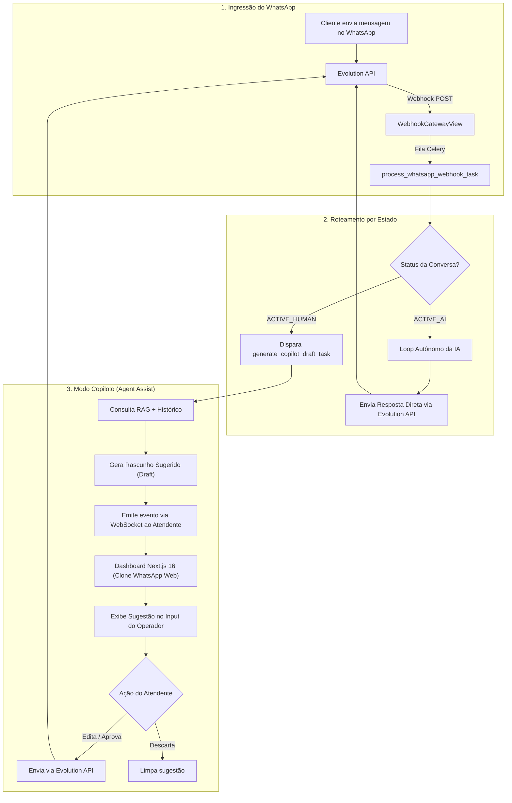
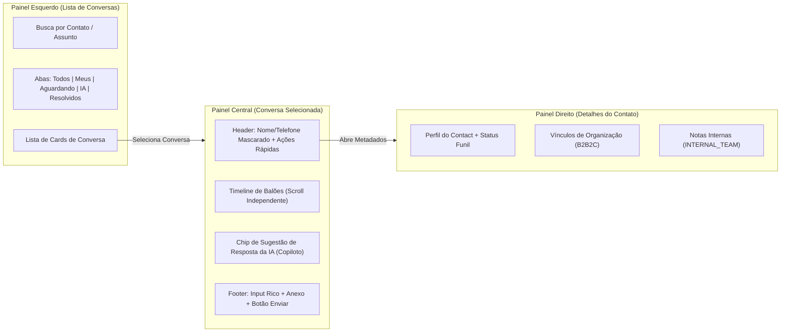

<!-- specs/005-omnichannel-integration/research-brainstorming.md | AI-Control v0.0.1 | 20-10-2026 05:00(GMT-04:00) -->

# 🧭 Bússola Arquitetural: Módulo Omnichannel & Pipeline de Triagem (Spec 005)
## Guia Mestre: Modelo B2B2C, IA Copiloto (Agent Assist), Layout WhatsApp Web Clone e Matriz de Migração

**Artefatos Relacionados:**
- [data-model.md](file:///home/andre/projetos/assistidos/ai-control/specs/005-omnichannel-integration/data-model.md) (Entidades, tipagem, Soft FKs, Blind Indexing e Máquina de Estados)
- [contracts/omnichannel_api_contracts.md](file:///home/andre/projetos/assistidos/ai-control/specs/005-omnichannel-integration/contracts/omnichannel_api_contracts.md) (REST DRF, Evolution API v2 Webhooks, WebSocket e Celery)
- [checklists/requirements.md](file:///home/andre/projetos/assistidos/ai-control/specs/005-omnichannel-integration/checklists/requirements.md) (Critérios de Aceite e Qualidade da Spec)
- [Roteiro Triagem de mensagem.md](file:///home/andre/projetos/assistidos/ai-control/Roteiro%20Triagem%20de%20mensagem.md) (Diretrizes de Triagem e PII)
- [AI-Control completo.md](file:///home/andre/projetos/assistidos/ai-control/AI-Control%20completo.md) (Mapeamento canônico de engenharia)

---

## 1. Visão Executiva e Tríade Canônica de Documentos

Este documento consolida as diretrizes invioláveis, o modelo de negócios B2B2C, o modo IA Copiloto e a arquitetura visual inspirada no WhatsApp Web, fundamentando-se na tríade:

1. **[`Roteiro Triagem de mensagem.md`](file:///home/andre/projetos/assistidos/ai-control/Roteiro%20Triagem%20de%20mensagem.md):** Carta fundacional de 977 linhas contendo a jornada do cliente, a dissociação de entidades (`Contact` vs `User`), a máquina de estados do atendimento, a política de sigilo/visibilidade e os protocolos de prevenção ativa de PII.
2. **[`AI-Control completo.md`](file:///home/andre/projetos/assistidos/ai-control/AI-Control%20completo.md):** Arquivo canônico de engenharia (8.085 linhas) contendo os prompts estruturados de NLU (`TRIAGE_PROMPT_V1_2`), especificações de serializers, contratos de API e a planta baixa de componentes do frontend (Sidebar, navegação, autenticação e gerenciamento de estado).
3. **Código Real Ativo em [`ai-control/`](file:///home/andre/projetos/assistidos/ai-control/):** Migrações consolidadas, modelos desacoplados por *Bounded Contexts*, Docker Compose com Evolution API v2 em `network_mode: "host"`, e o frontend sob Next.js 16 + React 19.

---

## 2. A Natureza do `Contact` e a Dinâmica do Modelo B2B2C

### 2.1. O que é REALMENTE o `Contact`?
- **Ponto de Entrada do Funil:** O `Contact` **não** é um usuário cadastrado com credenciais de login. O `Contact` representa **qualquer pessoa física que envia uma mensagem para a plataforma através de um número de WhatsApp não reconhecido**.
- **Por que NUNCA criar um `User` no primeiro contato:** 
  - Uma pessoa pode enviar uma única saudação ("Bom dia"), tirar uma dúvida isolada ou simplesmente errar o número e **nunca mais entrar em contato**.
  - Criar um registro na tabela interna `User` (Django Auth) nesse primeiro instante seria uma falha grave de arquitetura: inflaria a tabela de autenticação com milhares de registros órfãos, consumiria recursos de sessão/segurança desnecessariamente e violaria o princípio de privilégio mínimo do RBAC.
- **Captura e Qualificação Progressiva:**
  - O número chega ➔ O sistema cria imediatamente um `Contact` anônimo e o registra em `ContactPhoneNumber`.
  - Ao longo do diálogo (via IA ou atendente humano), informações contextuais são coletadas de forma natural (nome, e-mail, intenção de compra, suporte, reclamação).
  - O status evolui dinamicamente no ciclo de vida:
    $$\text{Número Desconhecido} \longrightarrow \text{PLATFORM\_LEAD} \longrightarrow \text{CUSTOMER\_LEAD} \longrightarrow \text{PROSPECT} \longrightarrow \text{CLIENT}$$

### 2.2. A Relação B2B2C (O Cliente Final da Organização Cliente)
- **A Plataforma (B2B):** Nós fornecemos a infraestrutura tecnológica de IA, CRM e governança para empresas contratantes (`Organization`).
- **A Empresa Cliente (`Organization`):** Utiliza a plataforma para atender seus próprios clientes, leads e parceiros comerciais.
- **O Cliente Final ("C" do B2B2C):** É o `Contact` que conversa pelo WhatsApp.
- **Isolamento de Vínculos Multi-Tenant:**
  - O vínculo entre o `Contact` e as organizações clientes é formalizado exclusivamente via [`ContactOrganizationMembership`](file:///home/andre/projetos/assistidos/ai-control/omnichannel/models.py#L80-L90).
  - Um mesmo cliente final pode interagir com a Empresa A (ex: concessionária) e com a Empresa B (ex: clínica médica) pelo mesmo WhatsApp. O sistema garante **isolamento absoluto**: os documentos, faturas, conversas e tickets da Empresa A jamais são visíveis para a Empresa B.
  - Se o contato procurar por uma empresa não cadastrada ou tiver interesse em contratar a plataforma de IA, o sistema o qualifica como `PLATFORM_LEAD` vinculado à nossa própria organização comercial interna.

---

## 3. O Modo IA Copiloto (Agent Assist): IA Contínua em `ACTIVE_HUMAN`

Ao contrário de sistemas arcaicos que desligam a IA por completo quando um humano assume, o **AI-Control** adota o padrão estado da arte da indústria (**Zendesk Agent Copilot, Intercom Fin Copilot e Chatwoot Captain**):

### 3.1. Como Funciona a Divisão de Responsabilidade
1. **Prevenção de Condição de Corrida (No Auto-Send):** Quando a conversa está em `ACTIVE_HUMAN`, a IA é **proibida de enviar mensagens autônomas diretamente para o WhatsApp do cliente**. Isso impede que o cliente receba duas respostas concorrentes.
2. **Assistência Contínua em Segundo Plano (Agent Assist):** Toda mensagem que o cliente envia enquanto a conversa está em `ACTIVE_HUMAN` dispara em segundo plano uma tarefa Celery (`generate_copilot_draft_task`).
3. **Geração do Rascunho Sugerido (Draft Mode):**
   - A IA consulta a base RAG da Organização + histórico imediato da conversa.
   - Gera uma **sugestão de resposta profissional e contextualizada**.
   - O backend emite via WebSocket (`debug_messages_{org_slug}`) o evento `copilot_draft_suggestion`.
4. **Experiência na Interface do Atendente:**
   - O rascunho surge imediatamente acima da caixa de digitação do atendente como um chip/card flutuante:  
     `💡 Sugestão da IA: "Olá João! Verifiquei seu contrato #789 e o status consta como 'Em Análise'. Deseja que eu emita a 2ª via?"`
   - O operador tem 3 ações com 1 clique:
     - **[Inserir no Campo]:** Transfere o texto para o `textarea`, permitindo editar, complementar ou reescrever antes de enviar.
     - **[Aprovar e Enviar]:** Dispara imediatamente a mensagem sugerida pela Evolution API.
     - **[Descartar]:** Fecha a sugestão sem qualquer impacto no cliente.

---

## 4. Design da Interface: Clone do WhatsApp Web para o Dashboard Empresarial

Para eliminar o formato monolítico atual de `/admin/core/debug/qr/` (onde todas as mensagens vinham misturadas em um único feed), a nova interface em `frontend/src/app/(dashboard)/conversations/page.tsx` replica a consagrada **experiência do WhatsApp Web**, separando rigorosamente cada conversa:

### 4.1. Arquitetura de Layout (Fixed Viewport Shell)
- **Container sem scroll de página (`h-dvh w-full overflow-hidden`):** A página inteira não rola; os painéis têm rolagem independente via scrollbars customizadas.
- **Estrutura Visual de 3 Painéis:**
  1. **Painel Esquerdo (Lista de Conversas — `w-full md:w-[350px] lg:w-[400px]`):**
     - Cabeçalho com avatar do operador, status de conexão da Evolution API e botão de nova conversa.
     - Barra de busca universal (busca por nome, número mascarado ou assunto).
     - Filtros em abas: **Todos**, **Meus Atendimentos**, **Aguardando Humano**, **Com IA**, **Resolvidos**.
     - Cards de conversa com: Avatar dinâmico, Nome/Telefone Mascarado, Badge de Organização/Squad, Prévia da última mensagem, Timestamp relativo e Badge numérico de mensagens não lidas.
  2. **Painel Central (Timeline da Conversa Ativa — `flex-1`):**
     - Cabeçalho do Chat: Nome do Contato, Badges de Status (`ACTIVE_AI` com pulso verde, `ACTIVE_HUMAN` com indicador âmbar), Ações Rápidas: *"Assumir Atendimento"*, *"Devolver para IA"*, *"Encerrar Atendimento"*.
     - Wallpaper sutil de fundo (estilo WhatsApp Web escuro/claro).
     - Balões de Mensagem:
       - Esquerda (Cinza/Neutro): Mensagens recebidas do cliente (`INBOUND`).
       - Direita (Verde/Indigo): Mensagens enviadas (`OUTBOUND`), com carimbo de autoria: *"Enviado por IA"* ou *"Enviado por Pedro (Atendente)"* + duplo check de entrega.
       - Mensagens de Sistema/Segurança: Destaque discreto centralizado (ex: *"Modo de Sigilo ativado"* ou *"Conversa transferida para Pedro"*).
     - Rodapé de Interação:
       - Barra de Sugestão da IA (Draft Copilot) retrátil.
       - Botão de Anexo / Mídia.
       - Caixa de Digitação com atalho `Enter` para envio.
       - Botão de Envio com feedback de loading otimista.
  3. **Painel Direito Retrátil (Drawer de CRM do Contato — `w-[320px]`):**
     - Perfil completo do `Contact`, status de qualificação (`PLATFORM_LEAD`, `CLIENT`, etc.).
     - Telefones adicionais associados (`ContactPhoneNumber`).
     - Organizações vinculadas (`ContactOrganizationMembership`).
     - Bloco de Notas Internas (`visibility_level == INTERNAL_TEAM`).

---

## 5. Matriz de Mapeamento: `AI-Control completo.md` (Legado) vs. Nova Stack (2026)

| Camada Arquitetural | Mapeamento no `AI-Control completo.md` (Design Legado) | Código Real a Ser Escrito na Nova Stack (2026) | Risco Mitigado (Por que não copiar?) |
| :--- | :--- | :--- | :--- |
| **1. Modelagem de Dados & Relacionamentos** | Tabelas centralizadas em `core/models.py` usando `ForeignKey(Organization)` e `ForeignKey(User)` em `Conversation`. | App desacoplado `omnichannel` com **Soft Foreign Keys puras via `UUIDField`** (`organization_id`, `squad_id`, `department_id`, `assigned_user_id`). | **Evita Quebra Relacional:** Chamar `select_related('organization')` gera `FieldError` imediato no Django. |
| **2. Proteção de PII & Blind Indexes** | Sugestão genérica de mascaramento em serializers na saída da API. | Criptografia em repouso com [`django-crypto-fields`](file:///home/andre/projetos/assistidos/ai-control/omnichannel/models.py#L7) (`EncryptedTextField`), blind index em `search_tokens` com **Postgres GIN Index** e busca de telefone via `phone_hash` determinístico. | **Conformidade LGPD/HIPAA:** Dados sensíveis nunca ficam em texto puro no banco, mesmo em dumps ou logs de auditoria. |
| **3. Governança e Hierarquia Organizacional** | Estrutura simplista baseada em `Organization` e `Team` com roles fixas (`ATTENDANT`, `SUPERVISOR`, `ORG_ADMIN`). | Governança corporativa **4-Tier (`Organization ➔ Department ➔ Project ➔ Squad`)**, onde colaboradores são alocados via `BaseMembership` e permissões são validadas matricialmente por `job_title.level == SCOPE`. | **Evita Quebra de Permissões:** O backend atual não possui tabela `Team`; permissões de chat dependem do escopo do Squad/Depto. |
| **4. Ingestão de Mensagens (WhatsApp Gateway)** | Views síncronas recebendo payloads abstratos do WhatsApp e despachando direto para a LLM. | View ultrarrápida [`WebhookGatewayView`](file:///home/andre/projetos/assistidos/ai-control/core/api/v1/views/webhook_whatsapp.py) (<50ms) com fila assíncrona Celery e normalização estrita via [`EvolutionWebhookAdapter.parse_messages`](file:///home/andre/projetos/assistidos/ai-control/core/adapters/evolution.py). | **Evita Timeouts e Mensagens Duplicadas:** A Evolution API reenvia webhooks se o servidor demorar > 2s para responder HTTP 200. |
| **5. Suporte da IA ao Atendente (Agent Assist)** | Apenas triagem autônoma inicial; IA ficava muda após a transição humana. | **Modo Copiloto Contínuo:** Celery gera sugestões em rascunho em background que preenchem o input do operador no dashboard com 1 clique. | **Eleva Produtividade:** O atendente humano mantém agilidade sem perder a governança da resposta final. |
| **6. Frontend: Arquitetura de Estado e Renderização** | React 18, Redux Toolkit (RTK) global, `useState` e `useEffect` imperativos para carregar dados em lista única misturada. | **Next.js 16 (App Router + Turbopack) + React 19**, com **TanStack Query v5 Singleton Factory** e layout **WhatsApp Web Clone multiconversa**. | **Evita Travamento de UI e Hidratação:** Separação estrita de conversas por rota/ID, eliminando o stream desordenado do painel de debug. |
| **7. Frontend: Comunicação em Tempo Real** | Conexões WebSocket puras abertas na inicialização da página gerenciando todo o estado do chat. | WebSocket leve via **Redis Channel Layers** (`DebugConsumer`) atuando estritamente como **invalidador de cache reativo** do TanStack Query (`queryClient.invalidateQueries`). | **Evita Desconexões e Memory Leaks:** A UI não quebra se o WebSocket oscilar, pois o TanStack Query mantém o estado consistente via REST. |
| **8. Motor de NLU & Inteligência Artificial** | Execução imediata do `TRIAGE_PROMPT_V1_2` com chamadas LLM a cada mensagem de entrada. | **Fatiamento Progressivo do Ciclo SDD:** • **v1 (Agora):** Loop fechado determinístico com saudação temporal contextual, menu de opções e Copiloto Draft básico. • **v2 (Próxima):** Invocação do Ollama local (`.env`) com parsing JSON estruturado de sentimento e ações. | **Garante Entrega Firme:** Isola a validação da infraestrutura de mensageria da calibração de latência/acurácia do modelo neural. |

---

## 6. Diagramas Arquiteturais de Fluxo (Mermaid)

### Diagrama 1: O Ciclo de Atendimento com IA Copiloto (Agent Assist)

---

### Diagrama 2: Navegação e Layout WhatsApp Web Clone no Next.js 16

---

## 7. Rastro de Grounding e Fontes Autorizadas

| # | Afirmação Técnica / Decisão | Status | Fonte Canônica no Repositório |
| :-: | :--- | :-: | :--- |
| 1 | `Contact` possui enums `PLATFORM_LEAD`, `CUSTOMER_LEAD`, `PROSPECT`, `CLIENT` | ✅ Real | [`omnichannel/models.py:L23-L28`](file:///home/andre/projetos/assistidos/ai-control/omnichannel/models.py#L23-L28) |
| 2 | `Conversation` e `Message` utilizam Soft FK `organization_id` (UUIDField) | ✅ Real | [`omnichannel/models.py:L104`](file:///home/andre/projetos/assistidos/ai-control/omnichannel/models.py#L104) |
| 3 | Evolution API roda em Docker com `network_mode: "host"` na porta 8080/8081 | ✅ Real | [`docker-compose.yml:L81-L120`](file:///home/andre/projetos/assistidos/ai-control/docker-compose.yml#L81-L120) |
| 4 | Webhook Gateway já despacha assíncrono via Celery | ✅ Real | [`core/api/v1/views/webhook_whatsapp.py:L69`](file:///home/andre/projetos/assistidos/ai-control/core/api/v1/views/webhook_whatsapp.py#L69) |
| 5 | Adaptação de mensagens normalizada em `EvolutionWebhookAdapter` | ✅ Real | [`core/adapters/evolution.py`](file:///home/andre/projetos/assistidos/ai-control/core/adapters/evolution.py) |
| 6 | Transmissão de eventos em tempo real via Redis Channels configurada | ✅ Real | [`core/consumers.py:L68-L136`](file:///home/andre/projetos/assistidos/ai-control/core/consumers.py#L68-L136) |
| 7 | Dashboard Next.js 16 já possui componente `OmnichannelCard` com slug | ✅ Real | [`frontend/src/components/dashboard/OmnichannelCard.tsx`](file:///home/andre/projetos/assistidos/ai-control/frontend/src/components/dashboard/OmnichannelCard.tsx) |
| 8 | Prompt Canônico de Triagem NLU estruturado em JSON com Sentimento e 4 Ações | ✅ Canônico | [`AI-Control completo.md:L2987-L3050`](file:///home/andre/projetos/assistidos/ai-control/AI-Control%20completo.md#L2987-L3050) |
| 9 | Princípio da API como Produto e Serializers como Fonte da Verdade | ✅ Canônico | [`AI-Control completo.md:L5630`](file:///home/andre/projetos/assistidos/ai-control/AI-Control%20completo.md#L5630) |
| 10 | Princípio P16: TanStack Query para Server-State e RTK para Client-State | ✅ Canônico | [`AI-Control completo.md:L5639, L5861`](file:///home/andre/projetos/assistidos/ai-control/AI-Control%20completo.md#L5639) |
| 11 | Especificação de Layout da Sidebar e Navegação da Área de Conversas (`/`) | ✅ Canônico | [`AI-Control completo.md:L7076-L7200`](file:///home/andre/projetos/assistidos/ai-control/AI-Control%20completo.md#L7076-L7200) |
| 12 | Contrato do Hook `useAuth` e Sessão com Interceptor Axios | ✅ Canônico | [`AI-Control completo.md:L7334-L7360`](file:///home/andre/projetos/assistidos/ai-control/AI-Control%20completo.md#L7334-L7360) |
| 13 | Jornada do Contato, 2FA Cruzado e Regras de Sigilo/Mudo/Arquivado | ✅ Canônico | [`Roteiro Triagem de mensagem.md:L1-L977`](file:///home/andre/projetos/assistidos/ai-control/Roteiro%20Triagem%20de%20mensagem.md#L1-L977) |

---

## 8. Fatiamento Estratégico para o Ciclo SDD (Spec 005)

1. **Fase 1 (Backend Foundation & Contratos REST Multi-Conversa):**
   - Migração para adicionar `department_id` e `squad_id` (Soft FKs UUID) em `Conversation`.
   - Implementação dos endpoints REST `/api/v1/omnichannel/conversations/` (listagem segmentada por conversa com filtros por status/squad, busca e paginação).
   - Endpoints da conversa ativa: `/api/v1/omnichannel/conversations/{id}/messages/`, ação de `takeover`, `release_to_ai` e `send_message`.
   - Correção do bug `conversation__organization_id` em `WhatsGtMessagesListView`.

2. **Fase 2 (Automação de Triagem & IA Copiloto no Celery):**
   - Quando `ACTIVE_AI`: loop determinístico com saudação contextual e menu de opções via `EvolutionGatewayService`.
   - Quando `ACTIVE_HUMAN`: bloqueio de envio autônomo ao WhatsApp e ativação da tarefa `generate_copilot_draft_task`, emitindo a sugestão via WebSocket ao operador.

3. **Fase 3 (Frontend Next.js 16 - Clone do WhatsApp Web):**
   - Construção do Shell `h-dvh` em `/conversations` no App Router com TanStack Query v5.
   - Painel Esquerdo: Lista de conversas separadas, busca por contato/assunto e abas de status.
   - Painel Central: Timeline WhatsApp-like, balões estilizados, carimbo de autoria e barra de rascunho com 1-clique (*"Inserir no Campo"* / *"Aprovar e Enviar"*).
   - Painel Direito: Drawer contextual do contato e notas internas.

4. **Fase 4 (Homologação E2E com o WhatsApp Real):**
   - Teste de ponta a ponta com o WhatsApp conectado na porta 8080.
   - Execução e garantia de 100% de sucesso na suíte de testes do pytest.
