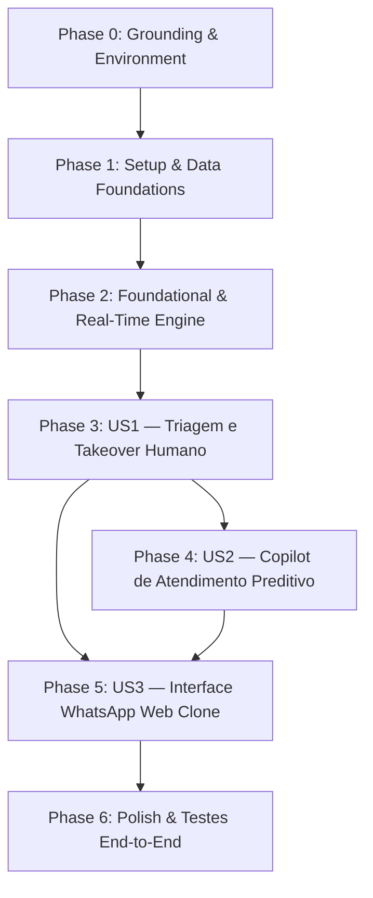

<!-- constitutional-status: APPROVED | auditor: red-team-vitalia | timestamp: 2026-10-20T18:32:33-04:00 | report: Relatório de inspeção.md -->
<!-- tasks.md | Vitalia SDD v0.6.0 | 20-10-2026 18:32:33(GMT-04:00) -->
> **tasks.md | Vitalia SDD v0.6.0 | 20-10-2026 18:32:33(GMT-04:00)**

# Tasks: 005-omnichannel-integration

**Spec**: [spec.md](file:///home/andre/projetos/assistidos/ai-control/specs/005-omnichannel-integration/spec.md) | **Plan**: [plan.md](file:///home/andre/projetos/assistidos/ai-control/specs/005-omnichannel-integration/plan.md)  
**Data**: 20-10-2026 18:08(GMT-04:00)

---

## MVP Scope

> **Definição de MVP:** A conclusão de **Phase 0 + Phase 1 + Phase 2 + Phase 3 (US1)** entrega a infraestrutura de dados estendida, as rotas da API REST sem vazamento de PII e a máquina de triagem com Takeover Humano funcional. As fases subsequentes agregam o Copiloto de IA (US2), a interface visual completa WhatsApp Web Clone (US3) e o polimento de produção.

---

## Phase 0: Grounding & Environment

- [X] T000-A Ativar ambiente virtual e validar dependências do backend: `source .venv/bin/activate`
- [X] T000-B [P] Verificar versão Python do venv (3.14): `python --version`
- [X] T000-C [P] Verificar integridade dos pacotes Python instalados: `pip check`
- [X] T000-D [P] Validar serviços conteinerizados via docker compose (`ai-control_db`, `ai-control_redis`, `ai-control_evolution`, `ai-control_ollama`): `docker compose ps`
- [X] T000-E [P] Executar a suíte de testes existente para garantir baseline sem regressões: `pytest tests/core/test_evolution_gateway.py core/tests/test_webhook_gateway.py`

---

## Phase 1: Setup & Data Foundations (Extensões Aditivas)

*Objetivo: Estender os modelos existentes em `omnichannel/models.py` de forma 100% não-destrutiva para suprir as 10 deficiências identificadas e blindar PII.*

- [X] T001 Estender o modelo `Contact` em `omnichannel/models.py` adicionando os campos aditivos `avatar_url` e `whatsapp_push_name` (null=True)
- [X] T002 Estender o modelo `Conversation` em `omnichannel/models.py` adicionando `unread_count`, `last_message_preview`, `is_pinned`, `channel_type`, `instance_name` e `tags`
- [X] T003 Estender o modelo `Message` em `omnichannel/models.py` adicionando `external_id`, `delivery_status`, `is_read`, `read_at`, `sender_user_id`, `media_type`, `media_url`, `media_mimetype`, `media_duration` e `quoted_message`
- [X] T004 Criar a nova entidade `CopilotDraft` em `omnichannel/models.py` com campos de sugestão, feedback humano (`final_sent_content`), status e latência
- [X] T005 Gerar e aplicar a migração não-destrutiva `0002_add_whatsapp_ui_extensions.py`: `python manage.py makemigrations omnichannel && python manage.py migrate`
- [X] T006 [P] Criar testes unitários para as extensões de modelo em `omnichannel/tests/test_extended_models.py`

---

## Phase 2: Foundational & Real-Time Engine

*Objetivo: Conectar o Channel Layer do Django Channels aos eventos de mensageria e estruturar serializers sem vazamento de PII.*

- [X] T007 [P] Criar serializers seguros em `omnichannel/api/serializers.py` implementando o campo calculado `display_name` e proibindo telefones em payloads públicos
- [X] T008 [P] Criar o WebSocket Consumer em `omnichannel/consumers/omnichannel_consumer.py` com autenticação JWT e isolamento multi-tenant por organização
- [X] T009 Registrar as rotas de WebSocket mapeando `ws/omnichannel/` no arquivo `config/routing.py`
- [X] T010 Atualizar `core/services/whatsapp_service.py` para sincronizar `push_name` no `Contact` e atualizar `last_message_preview` e `unread_count` na `Conversation`
- [X] T011 [P] Criar testes unitários do WebSocket consumer e channel layer em `omnichannel/tests/test_websocket_consumer.py` utilizando fixtures mockadas e sem credenciais reais

---

## Phase 3: User Story 1 — Triagem Determinística e Takeover Humano (US1)

**Story Goal**: Permitir que operadores visualizem a lista de conversas, acessem o histórico de mensagens e assumam ou devolvam o atendimento (`ACTIVE_HUMAN` $\leftrightarrow$ `ACTIVE_AI`), com bloqueio estrito de auto-respostas da IA.  
**Independent Test**: Simular mensagem inbound, acionar endpoint `/api/v1/omnichannel/conversations/{id}/takeover/` e verificar que o bot não responde e o status muda.  
**Referência**: FR-003, FR-004, FR-005

- [X] T012 [US1] Implementar `ConversationViewSet` em `omnichannel/api/views.py` com ações `list`, `retrieve`, filtros por status/aba e ordenação por `last_message_timestamp`
- [X] T013 [P] [US1] Implementar `MessageViewSet` em `omnichannel/api/views.py` com paginação do histórico e suporte a mensagens citadas (`quoted_message`)
- [X] T014 [US1] Implementar endpoints de ação `@action(detail=True, methods=['post'])` em `omnichannel/api/views.py`: `takeover` e `return-to-ai`
- [X] T015 [US1] Implementar trava lógica em `core/services/whatsapp_service.py` impedindo o disparo de mensagens autônomas da IA quando `conversation.status == ACTIVE_HUMAN` sem expor credenciais
- [X] T016 Registrar rotas da API em `omnichannel/api/urls.py` e plugar no roteador principal `config/urls.py`
- [X] T017 [P] [US1] Criar testes de integração da API de triagem e takeover em `omnichannel/tests/test_triage_takeover_api.py`

---

## Phase 4: User Story 2 — Copilot de Atendimento Preditivo com IA (US2)

**Story Goal**: Em conversas no modo `ACTIVE_HUMAN`, gerar sugestões de resposta automáticas via Ollama (`phi4-mini:latest`), transmiti-las via WebSocket e permitir aprovação de 1-clique pelo operador.  
**Independent Test**: Receber mensagem com conversa em `ACTIVE_HUMAN`, verificar emissão de evento WebSocket `copilot.draft.generated` e aprovação via API.  
**Referência**: FR-006

- [X] T018 [US2] Implementar service de sugestões contextuais `CopilotService` em `omnichannel/services/copilot_service.py` lendo modelo de `os.environ` com validação de input
- [X] T019 [US2] Criar a task Celery `generate_copilot_draft_task` em `omnichannel/tasks/copilot_tasks.py` para execução em segundo plano sem bloquear I/O
- [X] T020 [US2] Plugar o gatilho da task em `core/services/whatsapp_service.py` para conversas com status `ACTIVE_HUMAN`
- [X] T021 [US2] Implementar endpoints em `omnichannel/api/views.py` para aprovar (`/copilot-drafts/{id}/approve/`) e descartar drafts com disparo via `EvolutionGatewayService`
- [X] T022 [P] [US2] Criar testes automatizados do fluxo de sugestão e aprovação do copiloto em `omnichannel/tests/test_copilot_flow.py`

---

## Phase 5: User Story 3 — Interface de Atendimento WhatsApp Web Clone (US3)

**Story Goal**: Entregar a interface web corporativa completa em viewport fixo `h-dvh`, composta por 3 colunas articuladas, sem rolagem de janela, com suporte mobile e zero exibição de telefones.  
**Independent Test**: Acessar `/omnichannel` no navegador, verificar layout em 3 colunas (desktop), alternar para viewport mobile (<1024px) e verificar transição em pilha.  
**Referência**: FR-007, FR-008

- [X] T023 [P] [US3] Criar os tipos TypeScript em `frontend/src/types/omnichannel.ts` mapeando conversas, mensagens, contatos (sem telefone) e drafts
- [X] T024 [P] [US3] Criar hook de dados `useOmnichannel` em `frontend/src/hooks/use-omnichannel.ts` utilizando TanStack Query v5 Singleton
- [X] T025 [P] [US3] Criar hook reativo de WebSockets `useOmnichannelSocket` em `frontend/src/hooks/use-omnichannel-socket.ts` para invalidação de cache
- [X] T026 [P] [US3] Construir o componente `ConversationList` em `frontend/src/components/omnichannel/conversation-list.tsx` (Coluna 1) com busca, abas de filtro e badges
- [X] T027 [P] [US3] Construir o componente `ChatTimeline` em `frontend/src/components/omnichannel/chat-timeline.tsx` (Coluna 2) com balões de mensagem, ticks de entrega e players de áudio/mídia
- [X] T028 [P] [US3] Construir o componente `ChatHeader` em `frontend/src/components/omnichannel/chat-header.tsx` com avatar, nome do contato e botões de Takeover/Devolver IA
- [X] T029 [P] [US3] Construir o componente `ChatInput` em `frontend/src/components/omnichannel/chat-input.tsx` com suporte multiline, atalho Enter e anexo de mídias
- [X] T030 [P] [US3] Construir o componente `CopilotBanner` em `frontend/src/components/omnichannel/copilot-banner.tsx` com chip flutuante de sugestão e ações de 1-clique
- [X] T031 [P] [US3] Construir o componente `ContactDrawer` em `frontend/src/components/omnichannel/contact-drawer.tsx` (Coluna 3) com dados de CRM, tags e notas internas
- [X] T032 [US3] Montar a página principal em `frontend/src/app/(dashboard)/omnichannel/page.tsx` em container `h-dvh overflow-hidden` com responsividade mobile (drawer retrátil)
- [X] T033 [P] [US3] Criar testes unitários dos componentes React em `frontend/src/components/omnichannel/__tests__/`

---

## Phase 6: Polish, Observabilidade & Testes End-to-End

*Objetivo: Auditoria de segurança, telemetria de performance e validação integrada da stack completa.*

- [X] T034 [P] Criar comando Django de seed para ambiente de desenvolvimento: `python manage.py seed_omnichannel_demo` em `omnichannel/management/commands/seed_omnichannel_demo.py`
- [X] T035 [P] Implementar auditoria adversarial estrita de PII garantindo que nenhum telefone vaze nos logs ou responses: `omnichannel/tests/test_pii_sanitization.py`
- [X] T036 Adicionar logging estruturado de latência ($P95 \le 200\text{ms}$) no webhook e na geração de sugestões de copiloto
- [X] T037 Executar a suíte de testes de regressão no arquivo `tests/` e `omnichannel/tests/`: `pytest tests/ omnichannel/tests/`
- [X] T038 Validar os cenários de teste end-to-end descritos no arquivo `specs/005-omnichannel-integration/quickstart.md`

---

## Dependency Graph

---

## Parallel Execution

As seguintes tarefas marcadas com `[P]` podem ser executadas simultaneamente em paralelo dentro de suas respectivas fases:
- **Phase 0:** T000-B, T000-C, T000-D, T000-E
- **Phase 1:** T006
- **Phase 2:** T007, T008, T011
- **Phase 3:** T013, T017
- **Phase 4:** T022
- **Phase 5:** T023, T024, T025, T026, T027, T028, T029, T030, T031, T033
- **Phase 6:** T034, T035
