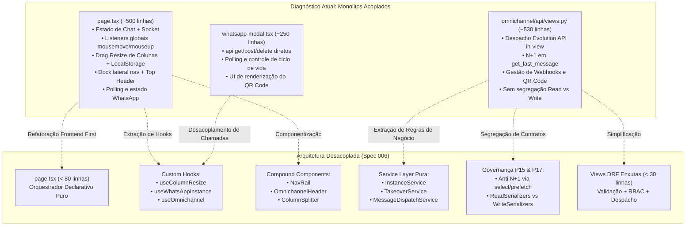

<!-- research-brainstorming.md | Vitalia SDD v0.6.0 | 20-10-2026 23:05:00(GMT-04:00) -->
> **research-brainstorming.md | Vitalia SDD v0.6.0 | 20-10-2026 23:05:00(GMT-04:00)**

# 🧭 Bússola Arquitetural: Desacoplamento & Arquitetura Limpa do Omnichannel (Spec 006)
## Guia Mestre de Refatoração: Decomposição de Monolitos, Service Layer no Backend, Princípios P15 (Anti N+1) e P17 (Serializers Read vs. Write), e Custom Hooks no Frontend

**Artefatos Relacionados:**
- [contracts/decoupling_contracts.md](file:///home/andre/projetos/assistidos/ai-control/specs/006-omnichannel-decoupling/contracts/decoupling_contracts.md) (Contratos de Tipagem TypeScript & Assinaturas Python da Service Layer)
- [spec.md](file:///home/andre/projetos/assistidos/ai-control/specs/006-omnichannel-decoupling/spec.md) (Especificação Funcional Formal, Critérios de Sucesso e Cenários Given/When/Then)
- [specs/005-omnichannel-integration/research-brainstorming.md](file:///home/andre/projetos/assistidos/ai-control/specs/005-omnichannel-integration/research-brainstorming.md) (Bússola de Origem do Omnichannel)
- [omnichannel/api/views.py](file:///home/andre/projetos/assistidos/ai-control/omnichannel/api/views.py) (Monolito de Views Atuais)
- [frontend/src/app/omnichannel/page.tsx](file:///home/andre/projetos/assistidos/ai-control/frontend/src/app/omnichannel/page.tsx) (Monolito de Viewport Atual)

---

## 1. Visão Executiva e Diagnóstico dos Monolitos

O módulo Omnichannel foi concebido e entregue de forma funcional na Spec 005. No entanto, o ritmo acelerado de incorporação de novas funcionalidades (chat multi-conversa, citação de mensagens, takeover de IA, modal de pareamento com QR Code, desconexão de instâncias WhatsApp e redimensionamento de colunas por arrasto) gerou uma **dívida técnica estrutural por acúmulo de responsabilidades**:



---

## 2. Princípios Constitucionais Vitalia Aplicados

1. **Princípio P01 (SDD Pipeline Inviolability):** Refatoração conduzida sob especificação formal, plano técnico e checklist de validação, impedindo desvios arquiteturais.
2. **Princípio P02 (User-Centric Validation):** A experiência do operador permanece 100% idêntica ou aprimorada: o viewport fixo sem scroll, as larguras memorizadas e a latência de interface são rigorosamente preservadas.
3. **Princípio P15 (Blindagem Anti N+1 no ORM):**
   * *Diagnóstico:* Atualmente, `ConversationListSerializer.get_last_message` executa `obj.messages.order_by('-timestamp').first()`. Em uma listagem de 50 conversas, isso dispara **51 queries** no PostgreSQL.
   * *Solução:* Eliminar consultas executadas dentro de serializers. O último preview já é desnormalizado em `Conversation.last_message_preview` e `Conversation.last_message_timestamp`. Nas queries de detalhe, aplicar obrigatoriamente `select_related('contact', 'assigned_operator', 'organization')` e `prefetch_related('tags')`.
4. **Princípio P17 (Segregação Estrita de Serializers: Read vs. Write):**
   * *Read Serializers:* Otimizados para saída do frontend, contendo objetos aninhados completos (`contact`, `quoted_message`, tags).
   * *Write Serializers:* Otimizados para validação estrita de entrada, sanitização e blindagem contra *Mass Assignment* (ex: `MessageCreateSerializer` aceita apenas `conversation_id`, `content`, `quoted_message_id`, `media_type`, `media_url`).
   * *Retrocompatibilidade:* Manter aliases explícitos para os 29 testes do backend não sofrerem `ImportError`.

---

## 3. Matriz de Transplante de Responsabilidades (De ➔ Para)

### 3.1. Frontend (Decomposição de `page.tsx` e `whatsapp-modal.tsx`)

| Bloco de Código no Monolito Atual | Linhas no `page.tsx` | Destino Modular Desacoplado | Responsabilidade Única |
| :--- | :--- | :--- | :--- |
| **Dock Lateral Esquerdo (Navigation Rail)** | `L239 - L303` | [`frontend/src/components/omnichannel/nav-rail.tsx`](file:///home/andre/projetos/assistidos/ai-control/frontend/src/components/omnichannel/nav-rail.tsx) | Renderizar barra de navegação estreita (`w-14`), logo AI-Control, botão de conversas, botão/status de WhatsApp e avatar do usuário. |
| **Barra Superior (Top Header)** | `L308 - L368` | [`frontend/src/components/omnichannel/omnichannel-header.tsx`](file:///home/andre/projetos/assistidos/ai-control/frontend/src/components/omnichannel/omnichannel-header.tsx) | Exibir título, organização ativa, atalho rápido de WhatsApp e badge de status do WebSocket (`ONLINE`/`OFFLINE`). |
| **Lógica Matemática de Drag & Drop (Sidebar & Drawer)** | `L50 - L138` | [`frontend/src/hooks/use-column-resize.ts`](file:///home/andre/projetos/assistidos/ai-control/frontend/src/hooks/use-column-resize.ts) | Encapsular estados de largura, `isDragging`, listeners no `window` (`mousemove`/`mouseup`), limites de segurança (min/max), cursor global e persistência no `localStorage`. |
| **Separadores Visuais de Redimensionamento (Splitters)** | `L387 - L401` e `L452 - L466` | [`frontend/src/components/omnichannel/column-splitter.tsx`](file:///home/andre/projetos/assistidos/ai-control/frontend/src/components/omnichannel/column-splitter.tsx) | Divisor vertical interativo com `cursor-col-resize`, feedback visual de hover e glow ativo (`cyan` para sidebar, `emerald` para CRM drawer). |
| **Ciclo de Vida & Requisições da Instância WhatsApp** | `whatsapp-modal.tsx` `L39 - L115` e `page.tsx` `L178 - L197` | [`frontend/src/hooks/use-whatsapp-instance.ts`](file:///home/andre/projetos/assistidos/ai-control/frontend/src/hooks/use-whatsapp-instance.ts) | Consultar status, emitir geração de QR Code, desconexão/logout e gerenciar estados de loading e toast notifications. |
| **Modal Visual de Pareamento WhatsApp** | `whatsapp-modal.tsx` `L117 - L252` | [`frontend/src/components/omnichannel/whatsapp-modal.tsx`](file:///home/andre/projetos/assistidos/ai-control/frontend/src/components/omnichannel/whatsapp-modal.tsx) | Renderização puramente visual do modal (box do QR Code, status badge e botões), consumindo o hook `useWhatsAppInstance`. |
| **Orquestrador de Página** | `page.tsx` restante | [`frontend/src/app/omnichannel/page.tsx`](file:///home/andre/projetos/assistidos/ai-control/frontend/src/app/omnichannel/page.tsx) | Agregação limpa de layout (< 80 linhas): consome os hooks e monta a composição declarativa dos painéis. |

---

### 3.2. Backend (Decomposição de `views.py` e `serializers.py`)

| Bloco de Código no Monolito Atual | Linhas no `views.py` | Destino Modular Desacoplado | Responsabilidade Única |
| :--- | :--- | :--- | :--- |
| **Ciclo de Vida da Instância WhatsApp (QR / Status / Logout)** | `L423 - L527` | [`omnichannel/services/instance_service.py`](file:///home/andre/projetos/assistidos/ai-control/omnichannel/services/instance_service.py) | Orquestrar comunicação com `EvolutionGatewayService`, resolver organização, garantir criação de instância, pareamento e auditoria de desconexão. |
| **Transbordo Humano & Devolução para IA (Takeover)** | `L90 - L147` | [`omnichannel/services/takeover_service.py`](file:///home/andre/projetos/assistidos/ai-control/omnichannel/services/takeover_service.py) | Transição atômica de status de conversa (`ACTIVE_AI` $\leftrightarrow$ `ACTIVE_HUMAN`), atribuição de operador, cancelamento de drafts e emissão de evento WebSocket. |
| **Despacho Outbound de Mensagens por Operador** | `L209 - L298` | [`omnichannel/services/message_dispatch_service.py`](file:///home/andre/projetos/assistidos/ai-control/omnichannel/services/message_dispatch_service.py) | Validação de JID do contato, resolução de quoted message, envio via Evolution API, persistência da mensagem e atualização de preview na conversa. |
| **Aprovação e Descarte de Sugestões de Copiloto** | `L364 - L421` | [`omnichannel/services/copilot_service.py`](file:///home/andre/projetos/assistidos/ai-control/omnichannel/services/copilot_service.py) | Processar aprovação de draft com envio outbound ou descarte limpo. |
| **Serializers de Leitura (Consultas Otimizadas)** | `serializers.py` `L45` e `L93` | [`omnichannel/api/serializers/read.py`](file:///home/andre/projetos/assistidos/ai-control/omnichannel/api/serializers/read.py) | `ConversationReadSerializer`, `MessageReadSerializer`, `ContactReadSerializer` (sem N+1). |
| **Serializers de Escrita (Validação Estrita de Input)** | Novo (Princípio P17) | [`omnichannel/api/serializers/write.py`](file:///home/andre/projetos/assistidos/ai-control/omnichannel/api/serializers/write.py) | `MessageCreateSerializer`, `TakeoverToggleSerializer`, `InstanceActionSerializer`. |
| **Views DRF Enxutas** | `views.py` restante | [`omnichannel/api/views.py`](file:///home/andre/projetos/assistidos/ai-control/omnichannel/api/views.py) | Cascas finas que validam payload com write serializers e delegam para services de domínio. |

---

## 4. Especificação Estrita de Contratos de Tipagem & Assinaturas

### 4.1. Frontend: Custom Hooks & Interfaces

#### Hook 1: `useColumnResize`
```typescript
export interface UseColumnResizeOptions {
  storageKey: string;
  defaultWidth: number;
  minWidth: number;
  maxWidth: number;
  direction?: 'left' | 'right'; // 'left' para Sidebar (clientX - offset); 'right' para Drawer (innerWidth - clientX)
  offset?: number;              // Deslocamento inicial da dock lateral (ex: 56px)
}

export interface UseColumnResizeReturn {
  width: number;
  isDragging: boolean;
  startDragging: (e: React.MouseEvent) => void;
  resetWidth: () => void;
}

export function useColumnResize(options: UseColumnResizeOptions): UseColumnResizeReturn;
```

#### Hook 2: `useWhatsAppInstance`
```typescript
export interface WhatsAppInstanceStatus {
  instanceName: string;
  state: 'open' | 'connecting' | 'close' | 'unknown';
  connected: boolean;
  qrCodeBase64: string | null;
}

export interface UseWhatsAppInstanceReturn {
  status: WhatsAppInstanceStatus;
  isLoading: boolean;
  isDisconnecting: boolean;
  refreshStatus: () => Promise<void>;
  generateQrCode: () => Promise<void>;
  disconnectInstance: () => Promise<boolean>;
}

export function useWhatsAppInstance(orgId?: string): UseWhatsAppInstanceReturn;
```

#### Componente: `NavRail`
```typescript
export interface NavRailProps {
  user: UserProfile | null;
  isWhatsAppConnected: boolean;
  onOpenWhatsAppModal: () => void;
  activeTab?: 'conversations' | 'settings';
}
```

#### Componente: `ColumnSplitter`
```typescript
export interface ColumnSplitterProps {
  isDragging: boolean;
  onMouseDown: (e: React.MouseEvent) => void;
  variant?: 'cyan' | 'emerald';
  title?: string;
}
```

---

### 4.2. Backend: Service Layer & Assinaturas Python

#### Service 1: `InstanceService` (`omnichannel/services/instance_service.py`)
```python
class InstanceService:
    @classmethod
    def get_status(cls, organization: Organization) -> dict:
        """
        Retorna: {
            "instance_name": str,
            "state": "open" | "connecting" | "close" | "unknown",
            "connected": bool,
            "qrcode_base64": Optional[str]
        }
        """

    @classmethod
    def generate_qr(cls, organization: Organization, request=None) -> dict:
        """
        Garante a criação da instância na Evolution API, associa webhook e obtém novo QR Code.
        """

    @classmethod
    def disconnect(cls, organization: Organization, actor: User) -> bool:
        """
        Executa logout da instância na Evolution API e registra AuditLog.
        """
```

#### Service 2: `TakeoverService` (`omnichannel/services/takeover_service.py`)
```python
class TakeoverService:
    @classmethod
    def assign_to_human(cls, conversation_id: uuid.UUID, operator: User) -> Conversation:
        """
        Executa trava atômica select_for_update.
        Atualiza status = ACTIVE_HUMAN, assigned_user_id = operator.id.
        Emite evento 'conversation_status_updated' no channel_layer.
        """

    @classmethod
    def return_to_ai(cls, conversation_id: uuid.UUID, actor: User) -> Conversation:
        """
        Executa trava atômica.
        Atualiza status = ACTIVE_AI, assigned_user_id = None.
        Emite evento 'conversation_status_updated' no channel_layer.
        """
```

#### Service 3: `MessageDispatchService` (`omnichannel/services/message_dispatch_service.py`)
```python
class MessageDispatchService:
    @classmethod
    def send_operator_message(
        cls,
        conversation_id: uuid.UUID,
        sender_user: User,
        content: str,
        quoted_message_id: Optional[uuid.UUID] = None,
        media_type: str = Message.MediaType.TEXT,
        media_url: Optional[str] = None
    ) -> Message:
        """
        Valida permissões, resolve contato e JID, envia via EvolutionGatewayService,
        persiste mensagem OUTBOUND no banco, atualiza conversa e emite WebSocket.
        """
```

---

## 5. Matriz de Serializers P17 & Retrocompatibilidade com os 29 Testes

Para atender com rigor ao **Princípio P17** sem quebrar testes existentes (`omnichannel/tests/`):

1. **`omnichannel/api/serializers/__init__.py`** manterá retrocompatibilidade exportando:
   ```python
   # Aliases canônicos de compatibilidade para suítes de teste existentes
   from .read import (
       ContactReadSerializer as ContactSerializer,
       ConversationReadSerializer as ConversationListSerializer,
       MessageReadSerializer as MessageSerializer,
       CopilotDraftReadSerializer as CopilotDraftSerializer,
       QuotedMessageSerializer,
   )
   from .write import (
       MessageCreateSerializer,
       TakeoverToggleSerializer,
       InstanceActionSerializer,
   )
   ```
2. **Eliminação do N+1 em `ConversationReadSerializer`:**
   * O campo `last_message` passará a ler os dados já desnormalizados da `Conversation` (`last_message_preview`, `last_message_timestamp`) ou através do `prefetch_related` já carregado em memória via cache do queryset (`obj.messages.all()[0]` em vez de query `.order_by().first()`).

---

## 6. Rastro de Pesquisa e Grounding (Fontes Canônicas)

| # | Afirmação | Verificado? | Fonte no Repositório | Data |
|---|-----------|-------------|----------------------|------|
| 1 | `page.tsx` acumula estado, drag de mouse e montagem de HTML em 500 linhas | ✅ Sim | [`frontend/src/app/omnichannel/page.tsx`](file:///home/andre/projetos/assistidos/ai-control/frontend/src/app/omnichannel/page.tsx) | 20-10-2026 |
| 2 | `views.py` executa lógica direta de envio WhatsApp na view `MessageViewSet.create` | ✅ Sim | [`omnichannel/api/views.py#L209-L298`](file:///home/andre/projetos/assistidos/ai-control/omnichannel/api/views.py#L209-L298) | 20-10-2026 |
| 3 | `ConversationListSerializer` executa query no método `get_last_message` (N+1) | ✅ Sim | [`omnichannel/api/serializers.py#L121`](file:///home/andre/projetos/assistidos/ai-control/omnichannel/api/serializers.py#L121) | 20-10-2026 |
| 4 | O frontend possui build Turbopack funcional e tipagem TypeScript 100% estrita | ✅ Sim | `npm run type-check` (código 0) | 20-10-2026 |
| 5 | A suíte de testes do backend possui 29 testes cobrindo triagem, takeover, PII e WebSocket | ✅ Sim | `.venv/bin/pytest omnichannel/tests` (29 passed em 29.86s) | 20-10-2026 |
