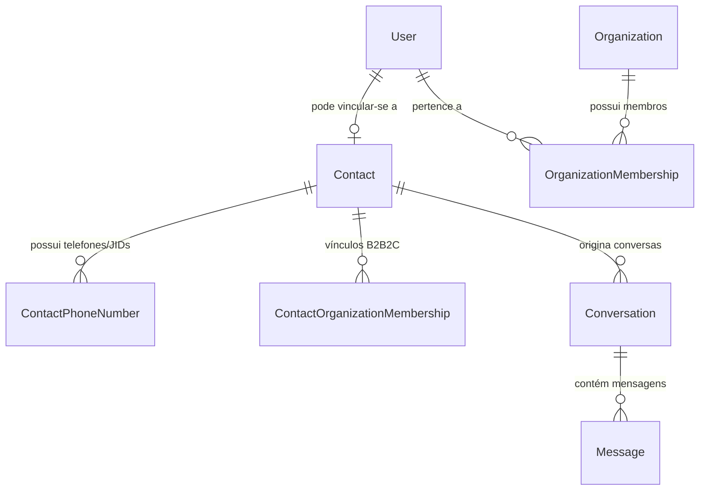
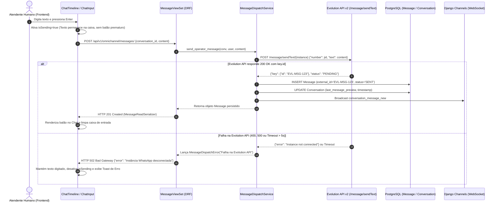

<!-- data-model.md | Vitalia SDD v0.6.0 | 21-10-2026 20:36:00(GMT-04:00) -->
> **data-model.md | Vitalia SDD v0.6.0 | 21-10-2026 20:36:00(GMT-04:00)**

# Data Model & State Architecture: 007-omnichannel-hardening

Este documento detalha o modelo de dados, as regras de integridade referencial para contatos novos sem organização versus contatos vinculados a usuários do sistema, e a governança de eventos da **Evolution API v2**.

---

## 1. Ontologia: Contact Novo vs. Contact com Usuário Vinculado

A arquitetura do AI-Control segrega expressamente o conceito de **Lead/Contato Externo (`Contact`)** do conceito de **Usuário do Sistema (`User`)**:

### Regras de Governança e Visibilidade (Decisão D1: C refinada com Organização Padrão - P07):

1. **Caso 1: `Contact` Novo (Sem `User` Vinculado):**
   - É um participante externo (ex: alguém que enviou mensagem espontânea pelo WhatsApp).
   - O contato possui `status = PLATFORM_LEAD`.
   - A `Conversation` e o `Contact` são associados automaticamente à **Organização Padrão da Plataforma** (determinada via helper `get_default_organization()` ou pela organização da instância WhatsApp receptora). O campo `organization_id` **NUNCA É NULO**.
   - **Regra de Acesso:** Operadores com permissão na organização padrão (ou administradores/suporte global) visualizam, listam e respondem a essa conversa normalmente, com todas as queries preservando o filtro mandatório `organization_id` (satisfazendo P07).

2. **Caso 2: `Contact` com `User` Vinculado:**
   - O contato possui um registro correspondente na tabela `core_user` (ex: mesmo telefone verificado, e-mail institucional ou cadastro corporativo).
   - **Regra de Acesso Mandatória:** O vínculo de organização pertence à organização desse `User`. O filtro de organização **DEVE** ser aplicado de forma estrita (`organization_id__in=authorized_orgs`). Apenas operadores membros da mesma organização podem visualizar e enviar mensagens nessa conversa. Operadores de organizações estranhas sofrem `HTTP 404 / 403`.

---

## 2. Catálogo Oficial de Eventos da Evolution API v2

A partir da análise do repositório oficial da Evolution API v2, os eventos foram classificados em duas categorias de processamento:

| Evento Evolution v2 | Categoria | Comportamento no Backend | Destino / Efeito |
| :--- | :---: | :--- | :--- |
| `messages.upsert` | **Acionável** | Enfileira no Celery | Grava `Message`, atualiza `Conversation` e emite via WebSocket. |
| `messages.update` | **Acionável** | Enfileira no Celery | Atualiza `delivery_status` da mensagem (Delivered ➔ Read / Ticks azuis). |
| `messages.edited` | **Acionável** | Enfileira no Celery | Atualiza `content` da mensagem editada com histórico de auditoria. |
| `messages.delete` | **Acionável** | Enfileira no Celery | Marca mensagem como revogada na timeline (`delivery_status='FAILED'`). |
| `qrcode.updated` | **Acionável** | Enfileira no Celery | Emite evento WebSocket `whatsapp.qrcode.updated` com Base64 para a UI. |
| `connection.update` | **Acionável** | Enfileira no Celery | Atualiza status com debounce no `AuditLog` para evitar flapping. |
| `presence.update` | **Silent Drop** | Retorna `200 OK` na View em $O(1)$ | Ignorado na borda (elimina flood de logs e saturação do Celery). |
| `contacts.set/upsert/update` | **Silent Drop** | Retorna `200 OK` na View em $O(1)$ | Ignorado na borda (agenda do aparelho não altera CRM diretamente). |
| `chats.set/upsert/update/delete`| **Silent Drop** | Retorna `200 OK` na View em $O(1)$ | Ignorado na borda. |
| `application.startup` | **Silent Drop** | Retorna `200 OK` na View em $O(1)$ | Confirmação de boot da Evolution API sem impacto na mensageria. |
| `call` | **Silent Drop** | Retorna `200 OK` na View em $O(1)$ | Chamadas VoIP do WhatsApp descartadas em $O(1)$. |

---

## 3. Fluxo de Sequência: Despacho Outbound com Confirmação Estrita (Decisão D2: A)

